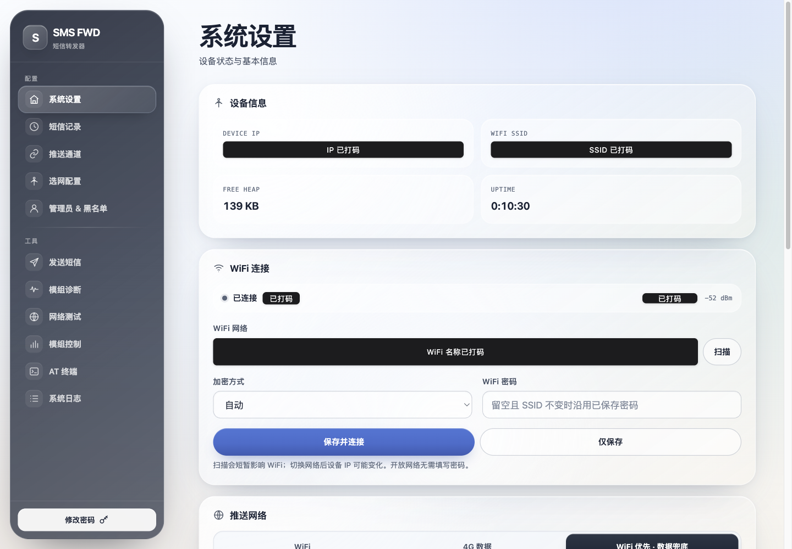
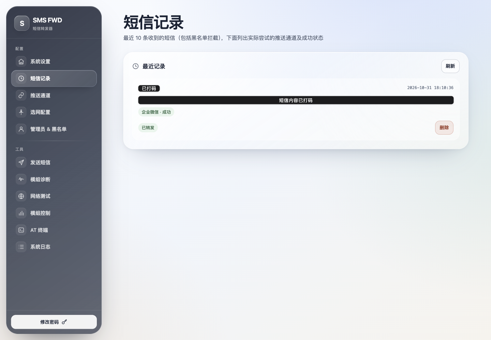
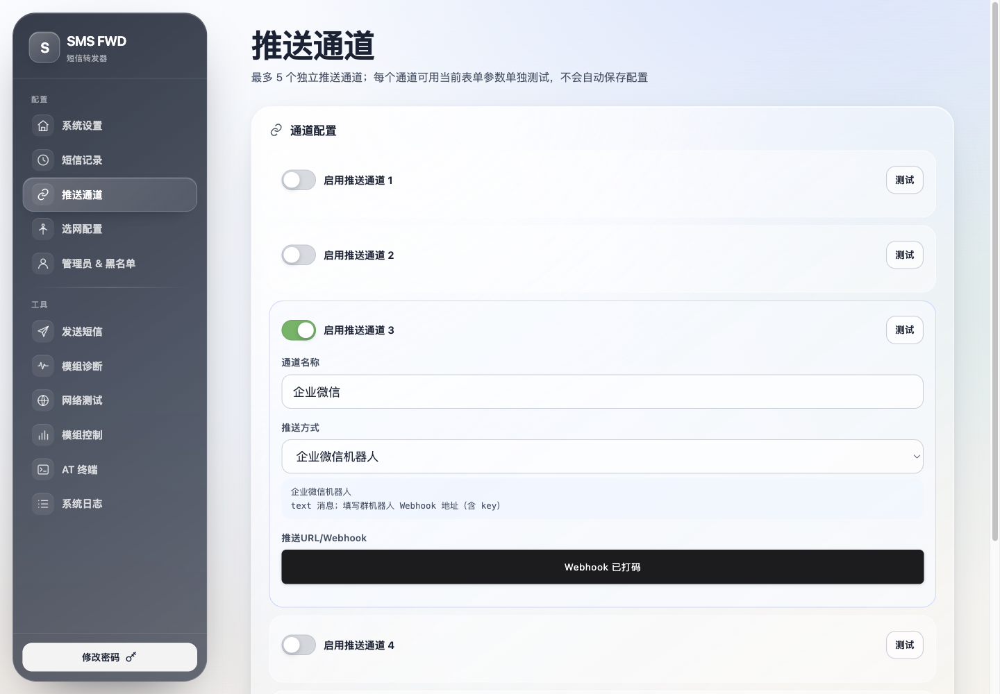
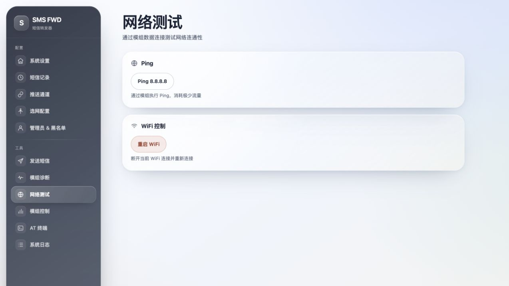

# Low-Cost SMS Forwarder

[English](README.md) | [简体中文](README_zh.md)

## Default Access

| Item | Value |
|---|---|
| Hotspot web management | `http://192.168.4.1` |
| Default hotspot password | `12345678` |
| Default administrator account | `admin` |
| Default administrator password | `admin123` |

The station IP is assigned by the router through DHCP and can change after reconnecting or moving to another network. If the address is no longer reachable, check the router's client list or the serial log. The default administrator password is used only until a new password is saved; change it after the first login.

## Highlights

- **AT-command based modem support** — works with ML307-series modules running their stock AT firmware.
- **Web management** — configure forwarding, inspect status, run diagnostics, and browse logs from a browser.
- **11 push types, up to 5 active channels** — each channel is configured independently.
- **SMS history** — keeps the latest 10 received messages, including messages blocked by the blacklist, admin commands, messages with no configured channel, and messages received while the selected push network was unavailable.
- **Per-channel delivery results** — every history entry records which channels were attempted and whether each attempt succeeded or failed; entries can be deleted individually.
- **Push testing** — each push channel can send a test message using the values currently in the form, without saving the configuration.
- **Push network routing** — choose WiFi only, 4G data only, or WiFi preferred with automatic 4G fallback.
- **WiFi configuration from the web UI** — scan nearby networks, choose an SSID, select the security mode, and save or save-and-connect.
- **Dual-band SSID handling** — at boot the firmware scans for the configured SSID and locks onto the strongest 2.4 GHz BSSID and channel, avoiding unusable 5 GHz virtual APs.
- **Device hotspot** — enabled by default with an SSID made from the last four MAC digits plus `短信转发`, WPA2-AES security, and a first-login prompt to change the default password.
- **Operator selection** — automatic by default, with optional manual PLMN selection for LTE.
- **Send SMS and ping from the web UI** — useful for keeping a SIM active and checking connectivity.
- **Long SMS reassembly** — concatenated SMS segments are merged automatically (up to 10 parts, 30-second timeout).
- **Admin SMS commands** — send an SMS or reboot the device remotely from the configured admin phone number.
- **Flexible blacklist** — exact number, number prefix, number suffix, and content-keyword rules; multiple keywords use OR logic.
- **Apple-style web interface** — responsive liquid-glass and frosted-glass design for desktop and mobile.

## Web UI

The single-page web interface contains the following panels:

| Panel | Purpose |
|---|---|
| **System Settings** | Device status, push network selection, WiFi connection, hotspot configuration, and system actions |
| **SMS History** | Latest 10 messages with per-channel delivery results and delete actions |
| **Push Channels** | Configure up to five channels and test each one |
| **Operator Selection** | Automatic or manual LTE operator selection |
| **Admin & Blacklist** | Admin phone number and blacklist rules |
| **Send SMS** | Send an SMS through the modem |
| **Modem Diagnostics** | Query modem information and signal status |
| **Network Test** | Ping tests and WiFi restart |
| **Modem Control** | Reset or power-cycle the modem |
| **AT Terminal** | Send AT commands to the modem |
| **System Log** | Live device log with automatic refresh |

The **Change Password** button at the bottom of the sidebar opens the account panel directly; account management is not a separate sidebar entry.

## Blacklist

The **Admin & Blacklist** panel supports four rule types:

- **Exact number** — matches the complete number.
- **Number prefix** — matches when the sender starts with the rule.
- **Number suffix** — matches when the sender ends with the rule.
- **Content keyword** — one keyword per line. Multiple keywords use **OR** logic: if the message body contains any one of them, the message is blocked.

Number matching ignores spaces, hyphens, and parentheses, and normalizes the `+86`, `86`, and `0086` prefixes. The blacklist is evaluated before pushing. A blocked message is not forwarded, but it is still written to SMS history. The admin number is always allowed through so that `SMS:` and `RESET` commands are not blocked.

Matching on the ESP32 is literal; regular expressions are not supported. Use a cloud worker or another upstream service if regex rules are required.

## Push Channels

The firmware supports the following 11 push types. Up to five channels can be enabled at the same time:

| Type | Description | Required configuration |
|---|---|---|
| **POST JSON** | Generic HTTP POST | URL |
| **Bark** | iOS push service | Bark server URL |
| **GET request** | Parameters in the URL query string | URL |
| **DingTalk bot** | Enterprise group notification | Webhook URL, optional secret signature |
| **PushPlus** | WeChat push service | Token |
| **ServerChan** | WeChat push service | SendKey |
| **Custom template** | Flexible JSON request body | URL and body template |
| **Feishu bot** | Custom notification | Webhook URL |
| **Gotify** | Self-hosted push service | Server URL and app token |
| **Telegram** | Bot API push | Chat ID and bot token |
| **WeCom bot** | Enterprise WeChat group robot, text message | Webhook URL including key |

### Payload formats

- **POST JSON**: `{"sender":"sender number","message":"SMS body","timestamp":"timestamp"}`
- **Bark**: `{"title":"sender number","body":"SMS body"}`
- **GET request**: `URL?sender=xxx&message=xxx&timestamp=xxx` with URL encoding
- **DingTalk bot**: text message, optional signed verification
- **PushPlus**: token-based push, HTML supported
- **ServerChan**: SendKey-based push, Markdown supported
- **Custom template**: `{sender}`, `{message}`, and `{timestamp}` placeholders
- **Feishu bot**: text message, optional signature verification
- **Gotify**: `{"title":"SMS from: sender","message":"SMS body\n\nTime: timestamp","priority":5}`
- **Telegram**: Bot API text message using Chat ID and bot token
- **WeCom bot**: `{"msgtype":"text","text":{"content":"..."}}` using a group-robot webhook URL

All push channels use a human-readable timestamp in `YYYY-MM-DD HH:MM:SS` format, for example `2026-10-31 18:10:36`.

### Push testing

Each channel in the **Push Channels** panel has its own **Test** button. A test uses the values currently entered in that channel's form (type, URL, parameters, and custom template), sends one message, and does not write to NVS or change the saved configuration. The test result is shown below the button, and detailed output is available in **System Log**. Tests follow the currently selected **Push Network** mode.

### Push network

The **Push Network** card in **System Settings** provides three modes. Changes take effect immediately, are written to NVS, and survive a reboot. The default is WiFi only.

- **WiFi** — push only over WiFi. If WiFi is not connected, nothing is sent and no cellular data is consumed.
- **4G data** — push only through the ML307A's cellular data connection, regardless of WiFi state. Cellular data charges may apply.
- **WiFi preferred · 4G fallback** — use WiFi when connected; if WiFi is unavailable or a transport-level failure occurs while establishing the connection, resolving DNS, or negotiating TLS, retry over 4G. HTTP 4xx responses, platform business errors, and read timeouts do not trigger a 4G retry, avoiding duplicate notifications.

4G pushing uses the ML307A MHTTP/HTTPS commands. HTTPS currently uses the module's default `auth=0` mode: traffic is still encrypted with TLS, but the certificate chain is not verified. Only push to trusted endpoints. Strict certificate verification would require loading a CA certificate into the module, which this firmware does not do.

## WiFi Settings

The **WiFi Connection** card in **System Settings** configures the access point that the ESP32 connects to as a station. This is separate from **Push Network**, which selects whether pushes use WiFi or 4G.

- **Scan** — calls `GET /wifi?action=scan`. The firmware scans synchronously and returns SSIDs sorted by signal strength, including RSSI, security type, and channel. Duplicate SSIDs are merged into the strongest entry, with up to 32 results. The web request waits during the scan, and the current WiFi connection may briefly drop; the firmware attempts to reconnect afterward.
- **Dual-band SSIDs** — the ESP32-C3 supports 2.4 GHz only. At boot, the firmware scans for the configured SSID and locks onto the strongest physical BSSID and channel, avoiding a 5 GHz virtual AP that the ESP32 cannot use.
- **Security mode** — `0` automatic, `1` open (no password), `2` WPA/WPA2, `3` WPA2, `4` WPA3. This sets the minimum security level accepted by the ESP32. With `0`, the firmware uses a WPA2 baseline; choose the explicit mode when connecting to an open or WPA/WPA2 network.
- **Save** — `POST /wifi?action=save` with `ssid`, `pass`, and `auth`. Saves to NVS without switching immediately; the new setting takes effect after a reboot. If the SSID is unchanged and the password is left empty, the saved password is reused. Open networks clear the saved password.
- **Save and connect** — `POST /wifi?action=connect` saves the values, disconnects the current WiFi, and connects with the new credentials, waiting up to about 15 seconds. The response is sent before the connection completes, so `success:true` means the request was accepted, not that the device is already online. DHCP may assign a new IP address; use the router's client list or the serial log to find the new address.
- **Restart WiFi** — the **Restart WiFi** button on the Network Test page calls `GET /wifi?action=restart`. It reconnects using the credentials already saved in NVS and does not read or modify the form.

Credentials are stored in the NVS namespace `wifi_config` under `ssid`, `pass`, and `auth`. `wifi_config.cpp` / `wifi_config.h` handle runtime loading, saving, and security levels. If no value has been saved, the compile-time defaults in `wifi_config.h` are used. Passwords are never returned by the status API or displayed in the UI.

WiFi settings affect only the ESP32 station connection (web management and WiFi push). The web UI still uses HTTP on port 80, and WiFi security does not change the 4G MHTTP HTTPS/certificate policy described above.

## Device Hotspot

The device enables a separate configuration hotspot by default. It runs in AP+STA mode, so connecting to the hotspot does not disable the existing WiFi connection or web management; the station IP usually remains reachable.

- Default SSID: last four digits of the device MAC plus `短信转发`, for example `6680短信转发` for MAC `80:53:e0:b7:66:80`.
- Default password: `12345678`.
- Security: WPA2-AES, fixed.
- Enabled by default; the hotspot address is usually `192.168.4.1`.
- The first login after initialization shows a prompt asking you to change the default hotspot password. Until it is changed, the hotspot card continues to show a warning.
- The **Hotspot Configuration** card in **System Settings** supports enabling/disabling the hotspot, changing the SSID, and changing the password. Changes apply immediately.
- Hotspot settings are stored in the NVS namespace `ap_config` under `enabled`, `ssid`, `pass`, `passChanged`, and `promptShown`. The first-login prompt is shown only once; the warning remains while the default password is unchanged.

Hotspot API: `GET /ap?action=status` returns the current state; `POST /ap?action=save` saves and applies `enabled` (`on` or empty), `ssid`, and `pass`. An empty password keeps the current one; passwords must be 8–63 characters.

## Operator Selection

The **Operator Selection** panel supports:

- **Automatic** — `AT+COPS=0`, letting the module choose the operator.
- **Manual** — enter a 5- or 6-digit PLMN (MCC + MNC, for example `46000`); the firmware runs `AT+COPS=1,2,"<PLMN>",7` to select LTE only.
- Saving a changed operator configuration reboots the device to apply it.
- The setting is stored in NVS `sms_config` as `operatorMode` and `operatorCode`; `operatorMode=0` (automatic) is the default.

## SMS History

The device records every received SMS, keeping the latest 10 entries and discarding the oldest when the limit is reached. This includes normally forwarded messages, messages blocked by a number or content rule, admin command messages, messages received when no valid push channel is configured, and messages received while the selected push network is unavailable.

Each entry contains the sender number, SMS timestamp, message body, processing status, reason (for example `number blacklist`, `content keyword`, or `admin command`), and the list of push channels actually attempted with each channel's success/failure result. Truncated message bodies are marked. Entries that were not pushed, such as blacklist hits, admin commands, or no-network cases, have an empty channel list.

Records are stored in SPIFFS at `/forward_history.bin` (file format version 2) and survive power loss and reboot. The **SMS History** panel lists all records and their delivery results and allows deleting entries one by one.

## Screenshots

| System Settings | SMS History |
|---|---|
|  |  |

| Push Channels | Network Test |
|---|---|
|  |  |

## Tested Hardware

This project was developed and verified on the following device:

| Item | Specification |
|---|---|
| MCU | ESP32-C3 QFN32, revision v0.4 |
| Flash | XMC 4 MB |
| Cellular module | ML307A-DSLN-MTSH1S00 (CMCC) |
| SIM | Nano SIM; China Unicom tested |
| Programming/debug port | ESP32-C3 USB-Serial/JTAG |
| Power | 5 V via USB |
| Antenna | 4G FPC antenna |

The ML307A-DSLN runs its stock AT firmware. The ESP32-C3 communicates with it over UART at 115200 baud. The tested unit has one accessible SIM slot; this firmware does not implement dual-SIM switching.

Other ESP32-C3 + ML307A boards should work if they expose the same UART and modem-enable pins, but they have not been verified.

## Wiring

The tested unit is an integrated ESP32-C3 + ML307A board, so no external wiring is required. For a custom build, connect the modem as follows:

```text
┌───────────────────────────────────────────────┐
|                                               |
|   ESP32-C3                ML307A module       |
| ┌───────────────────┐    ┌─────────────────┐ |
└─┼─ GPIO5 (MODEM_EN) │    │                 │ |
  │       GPIO3 (TX) ─┼───►│ RX              │ |
  │                   │    │             EN ─┼─┘
  │       GPIO4 (RX) ◄┼────┤ TX              │
  │                   │    │                 │
  │              GND ─┼────┤ GND             │
  │                   │    │                 │
  │               5V ─┼────┤ VCC (5V)        │
  │                   │    │                 │
  └───────────────────┘    └─────────────────┘
                           │                 │
                           │  SIM slot       │
                           │  (Nano SIM)     │
                           │                 │
                           │  Antenna port   │
                           │  (4G antenna)   │
                           └─────────────────┘
```

Connect the ESP32-C3 over USB for programming and power. During normal operation, the web UI can also be used to send AT commands to the modem for debugging.

## Software

- The ESP32-C3 runs the Arduino firmware in `code/`. It connects to WiFi, receives SMS data from the ML307A over UART, pushes messages through WiFi or 4G data according to the selected network mode, and writes local history.
- The ML307A-DSLN runs its stock AT firmware; no custom modem firmware is required.

Install the following library in Arduino IDE:

- **pdulib** by David Henry, version `0.5.11` (PDU SMS encoding/decoding)

Install ESP32 board support as described in the [official documentation](https://docs.espressif.com/projects/arduino-esp32/en/latest/installing.html). Select the ESP32-C3 board definition that matches your hardware; the tested unit uses a generic ESP32-C3, and the MakerGO ESP32 C3 SuperMini is also suitable for a DIY build.

### Build and flash

1. Install the ESP32 board package and `pdulib`.
2. Open `code/code.ino` in Arduino IDE.
3. Select the matching ESP32-C3 board and the correct serial port.
4. Compile and upload.

With `arduino-cli`, the equivalent commands are:

```bash
arduino-cli core install esp32:esp32
arduino-cli lib install "pdulib@0.5.11"
arduino-cli compile --fqbn esp32:esp32:esp32c3 code
arduino-cli upload --fqbn esp32:esp32:esp32c3 --port /dev/ttyUSB0 code
```

On Windows, replace `/dev/ttyUSB0` with the COM port shown by Device Manager.

### Prebuilt Firmware

A prebuilt application image for the tested ESP32-C3 + ML307A device is included in this repository:

- File: [`firmware/sms_forwarding-esp32c3-ml307a-20261031.bin`](firmware/sms_forwarding-esp32c3-ml307a-20261031.bin)
- Size: `1,236,192` bytes
- SHA-256: `a66db6738bcc539e57c8af366f06e2edacddcdf0d79ed03ab91e7f0873413fac` (also in [`firmware/SHA256SUMS`](firmware/SHA256SUMS))
- Source commit: `29174f8`
- Flash offsets for the tested 4 MB layout: `app0 @ 0x10000`, `app1 @ 0x1f0000`

This is the application image only; it does not contain the bootloader, partition table, or NVS. Writing just the app partitions preserves the existing WiFi, web login, push-channel, and other NVS settings.

```bash
esptool.py --chip esp32c3 --port /dev/ttyUSB0 --baud 460800 write_flash \
  0x10000 firmware/sms_forwarding-esp32c3-ml307a-20261031.bin \
  0x1f0000 firmware/sms_forwarding-esp32c3-ml307a-20261031.bin
```

## Project Structure

```text
code/
├── code.ino              # setup() and loop()
├── config_types.h        # enums, structs, and constants
├── globals.h / .cpp      # global objects and pin definitions
├── config.h / .cpp       # NVS configuration load/save and validation
├── modem.h / .cpp        # AT commands, modem power control, SMS sending
├── modem_http.h / .cpp   # ML307A MHTTP/HTTPS data channel
├── push.h / .cpp         # multi-channel push and signing helpers
├── history.h / .cpp      # SMS history (latest 10, SPIFFS persistence)
├── sms_process.h / .cpp  # PDU parsing, long SMS merge, blacklist, admin commands
├── web_handlers.h / .cpp # HTTP handlers and log ring buffer
├── web_html.cpp          # single-page web UI template
├── wifi_config.h / .cpp  # WiFi runtime configuration in NVS
└── ap_config.h / .cpp    # device hotspot configuration in NVS
```

Additional developer documentation is available in [`dev_doc/`](dev_doc/README.md) (Chinese).

## API Summary

| Endpoint | Method | Purpose |
|---|---|---|
| `/` | GET | Web UI |
| `/save` | POST | Save device, blacklist, operator, and push-channel configuration |
| `/history` | GET | Return SMS history as JSON |
| `/history` | POST | `action=delete&id=<id>` deletes one history entry |
| `/testpush` | POST | Send a test push using the submitted channel fields |
| `/pushnet` | POST | Set push network mode (`mode=0/1/2`) |
| `/sendsms` | POST | Send an SMS through the modem |
| `/ping` | POST | Run a ping test |
| `/wifi?action=status` | GET | WiFi status |
| `/wifi?action=scan` | GET | Scan nearby WiFi networks |
| `/wifi?action=save` | POST | Save WiFi credentials |
| `/wifi?action=connect` | POST | Save and connect to WiFi |
| `/wifi?action=restart` | GET | Reconnect using saved credentials |
| `/ap?action=status` | GET | Hotspot status |
| `/ap?action=save` | POST | Save and apply hotspot configuration |
| `/log` | GET | Return the log ring buffer as JSON |
| `/system?action=restart` | POST | Restart the ESP32 |
| `/at` | POST | Send an AT command to the modem |

All endpoints except the login page require HTTP Basic Authentication.

## Security Notes

- The web UI uses HTTP Basic Authentication over plain HTTP. Use it on a trusted LAN, and change the default web password after the first login.
- Change the default hotspot password on first login. The UI prompts for this, and continues to warn until it is changed.
- 4G HTTPS uses the module's `auth=0` mode: TLS encryption without certificate-chain verification. Only send pushes to endpoints you trust.
- The `AT` terminal and modem-control endpoints can disrupt connectivity; restrict access to the device's management network.

## License and Attribution

This project is distributed under the [MIT License](LICENSE). It is based on [chenxuuu/sms_forwarding](https://github.com/chenxuuu/sms_forwarding); the original copyright notice is retained in the license file.
